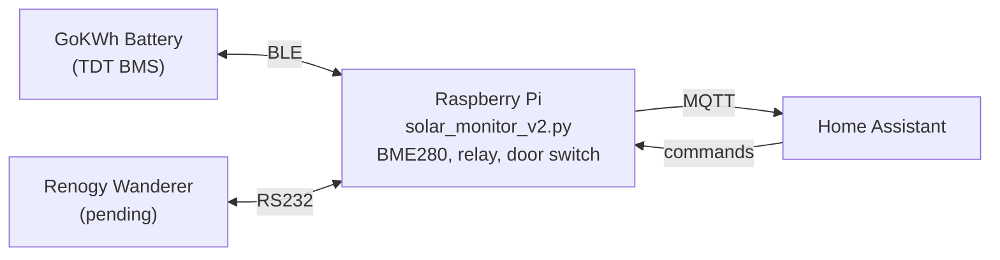

# Solar Monitor

Off-grid solar monitoring for Home Assistant via MQTT. Runs on a Raspberry Pi 3
B+ and publishes three independent devices — a GoKWh LiFePO4 battery (BLE), a
Renogy Wanderer charge controller (RS232, pending), and the Pi itself
(environmental sensors, enclosure management).

## Hardware

| Component | Interface | Status |
|-----------|-----------|--------|
| **GoKWh 100Ah LiFePO4** | Bluetooth LE (TDT BMS protocol) | ✅ Working |
| **Renogy Wanderer 10A PWM** | RS232 Modbus RTU | ⏳ Waiting on RS232-TTL adapter |
| **Raspberry Pi 3 B+** | Local GPIO / I²C | ✅ Working |
| 300W Inverter | — (no data interface) | — |
| 2× 100W Solar Panels | Via Wanderer | ⏳ |

### Pi Peripherals

- **BME280** — temperature, humidity, barometric pressure (I²C bus 3, GPIO23/24)
- **Relay module** — 12V exhaust fans (GPIO22)
- **Reed switch** — enclosure door sensor (GPIO27, NC to GND)

## Architecture



Each component appears as a **separate device** in Home Assistant with its own
availability tracking. The script uses independent async polling loops:

| Device | Poll Interval | Transport |
|--------|---------------|-----------|
| GoKWh Battery | 60s | BLE scan → connect → auth → poll → disconnect |
| Solar Pi | 2s | Local GPIO / I²C |
| Renogy Wanderer | TBD | RS232 Modbus RTU (not yet implemented) |

## Home Assistant Entities

### GoKWh Battery (`solar_gokwh/`)

| Entity | Type | Unit |
|--------|------|------|
| Pack Voltage | sensor | V |
| Pack Current | sensor | A |
| State of Charge | sensor | % |
| Remaining Capacity | sensor | Ah |
| Cycle Count | sensor | — |
| Cell 1–4 Voltage | sensor × 4 | V |
| Cell Delta | sensor | mV |
| BMS Temp 1–3 | sensor × 3 | °C |
| Protection Status | sensor (text) | — |
| Charge MOSFET | binary_sensor | — |
| Discharge MOSFET | binary_sensor | — |
| BLE Connected | binary_sensor | — |
| Firmware Version | sensor (text) | — |

### Solar Pi (`solar_pi/`)

| Entity | Type | Unit |
|--------|------|------|
| Enclosure Temperature | sensor | °C |
| Enclosure Humidity | sensor | % |
| Enclosure Pressure | sensor | hPa |
| CPU Temperature | sensor | °C |
| Fans Active | binary_sensor | — |
| Fan Mode | select (Auto/On/Off) | — |
| Enclosure Door | binary_sensor | — |

### Renogy Wanderer (`solar_wanderer/`)

Entities are registered in HA but show as unavailable until RS232 hardware is
connected. Will include: panel voltage/current/power, battery voltage/current,
charge state, load state, controller temperature.

## Installation

### Dependencies

```bash
sudo pip3 install bleak paho-mqtt RPi.bme280 smbus2 --break-system-packages
```

### Deploy

```bash
scp solar_monitor_v2.py pi:/opt/solar-monitor/
```

### Systemd Service

The service file is deployed to `/etc/systemd/system/solar-monitor.service` on
the Pi:

```ini
[Unit]
Description=Solar Monitor v2 — GoKWh + Renogy + Pi → Home Assistant
After=network-online.target bluetooth.target
Wants=network-online.target bluetooth.target

[Service]
Type=simple
User=root
EnvironmentFile=/opt/solar-monitor/.env
ExecStart=/usr/bin/python3 /opt/solar-monitor/solar_monitor_v2.py --mac ${BLE_MAC}
WorkingDirectory=/opt/solar-monitor
Restart=always
RestartSec=10
TimeoutStopSec=15
KillMode=mixed
StandardOutput=journal
StandardError=journal

[Install]
WantedBy=multi-user.target
```

Create `/opt/solar-monitor/.env` from the `.env.example` template:

```bash
cp .env.example /opt/solar-monitor/.env
# Edit with your actual values (MQTT creds, battery MAC, broker IP)
sudo nano /opt/solar-monitor/.env
```

### Bluetooth Configuration

The Pi 3 B+'s PL011 UART is used for Bluetooth (default assignment). The old
`miniuart-bt` overlay has been removed since the Waveshare RS485 HAT is no
longer in use. In `/boot/firmware/config.txt`:

```
# UART/BT overlays removed — PL011 stays on Bluetooth
#enable_uart=1
#dtoverlay=miniuart-bt
```

Bluetooth must be unblocked at boot:

```bash
sudo rfkill unblock bluetooth
sudo systemctl enable bluetooth
```

## Usage

```
python3 solar_monitor_v2.py [options]

Options:
  --mac MAC           GoKWh battery MAC address (required on Linux)
  --mqtt-host HOST    MQTT broker address (default: localhost)
  --mqtt-port PORT    MQTT broker port (default: 1883)
  --poll-interval SEC BLE poll interval in seconds (default: 60)
  --no-wanderer       Skip Renogy Wanderer discovery
  --no-pi             Skip Pi management (for local Mac testing)
  --debug             Enable debug logging
```

### Local Testing (Mac)

The script can run on a Mac for BLE testing against a nearby battery. GPIO and
BME280 features are auto-disabled when their libraries aren't available:

```bash
python3 solar_monitor_v2.py --no-pi --no-wanderer
```

## Reliability Features

### BLE Resilience

The Pi 3 B+'s onboard Bluetooth (BCM43430 via UART) is prone to firmware
hangs, especially after GATT errors or rapid reconnection cycles. The script
handles this with:

- **Poll timeout** — each BLE cycle is capped at 45s via `asyncio.wait_for()`
  to prevent indefinite hangs on wedged BlueZ calls
- **Escalating BlueZ reset** — after 5 consecutive failures:
  1. `btmgmt` power cycle (clears stuck scans)
  2. `rfkill` block/unblock + bluetooth service restart
  3. Full system reboot as last resort
- **Connect-per-poll** — scan → connect → auth → read → disconnect each cycle;
  avoids long-lived BLE connections that conflict with the GPKWD phone app

### MQTT Resilience

- `connect_async()` with paho's background thread — non-blocking reconnection
- `on_connect` republishes all discovery configs and availability on reconnect
- MQTT LWT (Last Will and Testament) marks the battery offline if the script
  dies unexpectedly

### Task Supervision

Each polling loop (battery, Pi, wanderer) runs as an independent `asyncio`
task. A supervisor callback detects dead tasks and restarts them after 5
seconds. Outer try/except blocks around each loop body prevent any single error
from killing a task.

## GoKWh BLE Protocol (TDT BMS)

The GoKWh battery uses a **TDT BMS** (manufacturer prefix `XDZN`). The BLE
protocol was reverse-engineered from the open-source
[aiobmsble](https://github.com/patman15/aiobmsble) library.

### GATT Profile

| Service | Characteristic | Properties | Role |
|---------|---------------|------------|------|
| `0xfff0` | `0xfff1` | Read, Notify | BMS → Host (responses) |
| `0xfff0` | `0xfff2` | Read, Write, Write-no-resp | Host → BMS (commands) |
| `0xfff0` | `0xfffa` | Read, Write, Write-no-resp | Auth/config |

### Authentication

Write `b"HiLink"` to `0xfffa`, read back — `0x01` means unlocked.

### Command Frame

```
[HEAD=0x7E] [VER=0x00] [0x01] [0x03] [0x00] [CMD] [LEN_HI] [LEN_LO] [DATA...] [CRC_HI] [CRC_LO] [0x0D]
```

CRC is Modbus CRC-16 over all bytes before the 3-byte trailer, stored
big-endian.

### Commands

| CMD | Description | Key Data |
|-----|-------------|----------|
| `0x8C` | Battery data | Cell voltages, temperatures, pack V/I, SOC, cycles |
| `0x8D` | Protection status | Problem codes, charge/discharge MOSFET state |
| `0x92` | Device info | Firmware version, serial number |

## File Structure

```
solar_monitor_v2.py          ← Production monitoring script
solar-monitor.service        ← Systemd unit file (repo copy, deployed to Pi)
solar-cameras-optimized.yaml ← Home Assistant dashboard config
WIRING.md                    ← Current wiring & hardware reference
ble-probe/                   ← BLE reverse-engineering tools (development)
  scan.py                      Scan for BMS devices
  enumerate.py                 Enumerate GATT services/characteristics
  jbd_probe.py                 JBD protocol probe (not the right protocol)
  probe_all.py                 All-in-one scan+enumerate+probe
  raw_probe.py                 Brute-force characteristic probe
```
