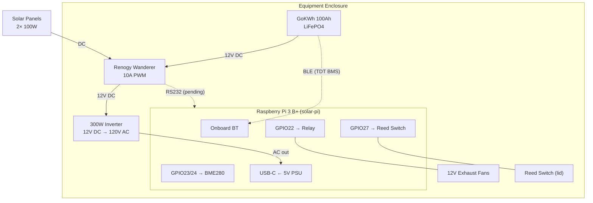

# Solar Monitor — Wiring & Hardware Setup

## Overview

The solar monitoring system runs on a **Raspberry Pi 3 B+** in a weatherproof
enclosure alongside the solar equipment. The Pi communicates with the GoKWh
battery via Bluetooth LE and manages enclosure climate with fans and sensors.



## Pi GPIO Pin Assignment

| Pi Pin (BCM) | Function | Connected To |
|--------------|----------|--------------|
| GPIO22 | Fan relay control | Relay module IN (active HIGH) |
| GPIO27 | Door sensor | NC reed switch to GND (LOW = closed) |
| GPIO23 | I²C SDA (bus 3) | BME280 SDA |
| GPIO24 | I²C SCL (bus 3) | BME280 SCL |
| 3.3V | Sensor power | BME280 VCC |
| 5V | Relay power | Relay module VCC |
| GND | Common ground | All peripherals |

### BME280 Sensor (I²C)

The BME280 is on a software-defined I²C bus (bus 3) using GPIO23/24, configured
in `/boot/firmware/config.txt`:

```
dtoverlay=i2c-gpio,bus=3,i2c_gpio_sda=23,i2c_gpio_scl=24
```

Address: `0x76`. Verify with `i2cdetect -y 3`.

### Fan Relay

A single-channel relay module switches 12V exhaust fans. The relay is driven by
GPIO22 (3.3V logic, active HIGH). The fan control has three modes settable from
Home Assistant:

- **Auto** — turns on when battery or enclosure temp ≥ 60°C, off when ≤ 55°C.
  Also runs a 90-second keepalive pulse every 4 hours to prevent stagnant air.
- **On** — fans always on
- **Off** — fans always off

### Door Switch

A normally-closed reed switch is mounted on the enclosure lid. One terminal
connects to GPIO27, the other to GND. GPIO27 is configured with an internal
pull-up resistor:

- **Door closed** → switch closed → GPIO27 LOW
- **Door open** → switch open → GPIO27 pulled HIGH

## Bluetooth

The Pi 3 B+ uses its **onboard BCM43430** Bluetooth controller. The PL011 UART
is assigned to Bluetooth (default configuration — the `miniuart-bt` overlay is
NOT used).

The old Waveshare RS485 CAN HAT has been removed. When the Renogy RS232
adapter arrives, a USB-UART adapter will be used instead to avoid the
PL011/Bluetooth conflict.

### Bluetooth Quirks

The BCM43430 communicates with the host via UART. Under certain error
conditions (GATT protocol errors, rapid connect/disconnect cycles), the
Bluetooth firmware can become unresponsive. The monitoring script includes an
escalating reset mechanism:

1. `btmgmt` power cycle
2. `rfkill` block/unblock + bluetooth service restart
3. Full system reboot (last resort)

## Power

The Pi is powered by a 5V/2.5A USB-C supply fed from the inverter's AC output.
During power outages, the GoKWh battery sustains the entire system (Pi + cameras
+ network gear) — the monitoring script continues running on battery power.

## Renogy Wanderer RS232 (Planned)

The Renogy Wanderer 10A PWM charge controller has an RS232 port (RJ12
connector). Communication requires an **RS232-TTL level shifter** (MAX3232 or
similar) connected to a USB-UART adapter on the Pi.

- Protocol: Modbus RTU, 9600 baud, 8N1
- Library: [renogymodbus](https://github.com/rosswarren/renogymodbus)
- Registers: 0x0100–0x010F (panel V/I, battery V/I, charge state, temps)

This integration is blocked on the RS232-TTL adapter delivery.

## Network

| Device | IP | Role |
|--------|----|------|
| solar-pi | (your Pi IP) | Monitoring Pi |
| MQTT broker | (your broker IP):1883 | Home Assistant MQTT |

